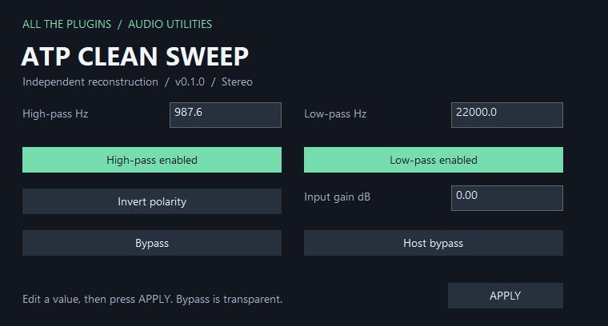

# ATP Clean Sweep 0.1.0

Windows x64 VST3 functional reconstruction of bx_cleansweep V2's audio controls, with an independent name, identity and editor. It contains no original vendor executable, artwork or activation system and is not affiliated with Brainworx or Plugin Alliance.

[Download the VST3 module](https://raw.githubusercontent.com/someonelikeTIM/all-the-plugins/main/plugins/vst3/win-x64/ATP%20Clean%20Sweep.vst3/Contents/x86_64-win/ATP%20Clean%20Sweep.vst3).

## Install and use

Download the repository ZIP and copy the complete `plugins/vst3/win-x64/ATP Clean Sweep.vst3` folder into `%LOCALAPPDATA%\Programs\Common\VST3` or your system VST3 folder, then rescan your host. Windows 10/11 x64 with Universal C Runtime is required. The bundle contains one module, has no external sample/preset dependencies, and is unsigned.

| Control | Behavior |
| --- | --- |
| High-pass Hz | 20–11,000 Hz, logarithmic |
| Low-pass Hz | 20–22,000 Hz, logarithmic |
| Filter enable buttons | Independently enable each first-order, nominal 6 dB/octave filter |
| Input gain dB | −12 to +12 dB |
| Invert polarity | Reverses both channels |
| Bypass / Host bypass | Transparent bypass of the entire signal chain |

Type numeric values and click **APPLY**. Host parameters remain continuous and automatable. Default cutoffs are 20 Hz/22 kHz with both filters enabled and 0 dB gain. Processing is stereo, zero-latency, and supports 32/64-bit floating point. Sample rates from 44.1 to 384 kHz are supported.

## License

This specific independently implemented binary is licensed under the MIT license reproduced below. The repository's existing GPL-3.0 license remains in place for repository material; it does not replace this binary's explicit license. Required bundled library notices are in [THIRD-PARTY-NOTICES.md](THIRD-PARTY-NOTICES.md).

Copyright (c) 2026 someonelikeTIM

Permission is hereby granted, free of charge, to any person obtaining a copy of this software and associated documentation files (the "Software"), to deal in the Software without restriction, including without limitation the rights to use, copy, modify, merge, publish, distribute, sublicense, and/or sell copies of the Software, and to permit persons to whom the Software is furnished to do so, subject to the following conditions:

The above copyright notice and this permission notice shall be included in all copies or substantial portions of the Software.

THE SOFTWARE IS PROVIDED "AS IS", WITHOUT WARRANTY OF ANY KIND, EXPRESS OR IMPLIED, INCLUDING BUT NOT LIMITED TO THE WARRANTIES OF MERCHANTABILITY, FITNESS FOR A PARTICULAR PURPOSE AND NONINFRINGEMENT. IN NO EVENT SHALL THE AUTHORS OR COPYRIGHT HOLDERS BE LIABLE FOR ANY CLAIM, DAMAGES OR OTHER LIABILITY, WHETHER IN AN ACTION OF CONTRACT, TORT OR OTHERWISE, ARISING FROM, OUT OF OR IN CONNECTION WITH THE SOFTWARE OR THE USE OR OTHER DEALINGS IN THE SOFTWARE.
