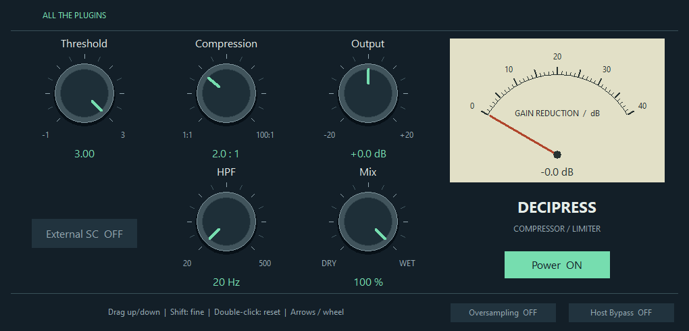

# ATP DeciPress
---
A program-dependent compressor and limiter with five rotary controls, external sidechain, dry/wet mixing, oversampling, and a gain-reduction meter.

**Inspired by:** Analog Obsession dBComp

# Downloads
---
| Platform | Format | Download |
| --- | --- | --- |
| Windows | VST3 | [Download ZIP](https://raw.githubusercontent.com/someonelikeTIM/all-the-plugins/main/downloads/windows/ATP-DeciPress-Windows-VST3.zip) |

# Install and use
---
**Windows:** Extract the ZIP, copy the whole `ATP DeciPress.vst3` folder to `C:\Program Files\Common Files\VST3`, then rescan your host.

When replacing a prior ATP build, remove its previous bundle before copying this one. Do not keep both builds installed: they share the same VST3 identity.

| Control | Behavior |
| --- | --- |
| Threshold | Position from -1.00 to 3.00; lower values reduce the internal threshold from 0 dB toward -96 dB and produce more compression. Default: 3.00. |
| Compression | Ratio from 1.0:1 to 100.0:1 on the preserved nonlinear control law. Default: 2.0:1. |
| Output Gain | Post-compressor output level from -20 to +20 dB. Default: 0 dB. |
| HPF | High-pass cutoff for the linked detector and external sidechain, from 20 to 500 Hz. Default: 20 Hz. |
| MIX | Dry/wet blend from 0% dry to 100% compressed. Default: 100%. |
| External SC | Uses the host-routed Aux input for detection while the Main input remains the processed signal. Default: Off. |
| Power | Internal power bypass. Off returns immediate dry audio and changes effective oversampling latency to 0; On restores the active oversampled latency and requests a host latency restart when needed. Default: On. |
| Oversampling | Enables the antialiased processing path. While processing is active it reports 64 samples of latency; changes request a VST3 latency restart. Default: Off. |
| Host Bypass | VST3 host bypass. Loaded bypassed, it is immediate dry at 0 latency. Engaged during active oversampling, it freezes compressor state and keeps a 64-sample compensated dry path until re-enabled. |
| Gain Reduction meter | Read-only live needle and numeric feedback from the smoothed gain-reduction state. The needle spans 0–40 dB and the numeric value can show more; it reads INACTIVE while Power is off or host bypass is enabled. It is not an output-level or calibrated VU meter. |

Drag a knob vertically for immediate adjustment; hold Shift for fine movement. Mouse wheel and arrow keys adjust a focused knob, Home/End select its limits, and double-click or Enter resets its default. Tab follows the visual control order. Switches activate on release; moving outside or losing capture cancels the click. Host automation and restored state refresh automatically.

Insert on a mono or stereo track. For external keying, route a mono or stereo signal to the Aux bus and enable External SC. Defaults are Threshold 3.00, Compression 2.0:1, Output Gain 0 dB, HPF 20 Hz, MIX 100%, Power on, External SC off, Oversampling off and host Bypass off. Supports 32-bit and 64-bit audio from 44.1 to 384 kHz. Automation uses the last queued parameter value for the whole processing block; it is not sample-accurate.

# License
---
This specific independently implemented binary is licensed under the MIT license reproduced below. The repository's existing GPL-3.0 license remains in place for repository material; it does not replace this binary's explicit license. Required bundled library notices are included in full below.

Copyright (c) 2026 someonelikeTIM

Permission is hereby granted, free of charge, to any person obtaining a copy of this software and associated documentation files (the "Software"), to deal in the Software without restriction, including without limitation the rights to use, copy, modify, merge, publish, distribute, sublicense, and/or sell copies of the Software, and to permit persons to whom the Software is furnished to do so, subject to the following conditions:

The above copyright notice and this permission notice shall be included in all copies or substantial portions of the Software.

THE SOFTWARE IS PROVIDED "AS IS", WITHOUT WARRANTY OF ANY KIND, EXPRESS OR IMPLIED, INCLUDING BUT NOT LIMITED TO THE WARRANTIES OF MERCHANTABILITY, FITNESS FOR A PARTICULAR PURPOSE AND NONINFRINGEMENT. IN NO EVENT SHALL THE AUTHORS OR COPYRIGHT HOLDERS BE LIABLE FOR ANY CLAIM, DAMAGES OR OTHER LIABILITY, WHETHER IN AN ACTION OF CONTRACT, TORT OR OTHERWISE, ARISING FROM, OUT OF OR IN CONNECTION WITH THE SOFTWARE OR THE USE OR OTHER DEALINGS IN THE SOFTWARE.

# Third-party notices
---
This plugin includes Steinberg VST3 SDK components and LLVM / libc++ runtime components. Their full notices and distribution terms follow.

# Steinberg VST3 SDK
---
MIT License

Copyright (c) 2026, Steinberg Media Technologies GmbH

Permission is hereby granted, free of charge, to any person obtaining a copy of this software and associated documentation files (the "Software"), to deal in the Software without restriction, including without limitation the rights to use, copy, modify, merge, publish, distribute, sublicense, and/or sell copies of the Software, and to permit persons to whom the Software is furnished to do so, subject to the following conditions:

The above copyright notice and this permission notice shall be included in all copies or substantial portions of the Software.

THE SOFTWARE IS PROVIDED "AS IS", WITHOUT WARRANTY OF ANY KIND, EXPRESS OR IMPLIED, INCLUDING BUT NOT LIMITED TO THE WARRANTIES OF MERCHANTABILITY, FITNESS FOR A PARTICULAR PURPOSE AND NONINFRINGEMENT. IN NO EVENT SHALL THE AUTHORS OR COPYRIGHT HOLDERS BE LIABLE FOR ANY CLAIM, DAMAGES OR OTHER LIABILITY, WHETHER IN AN ACTION OF CONTRACT, TORT OR OTHERWISE, ARISING FROM, OUT OF OR IN CONNECTION WITH THE SOFTWARE OR THE USE OR OTHER DEALINGS IN THE SOFTWARE.

# LLVM / libc++ runtime
---
The LLVM Project is under the Apache License v2.0 with LLVM Exceptions:

Apache License Version 2.0, January 2004 http://www.apache.org/licenses/

TERMS AND CONDITIONS FOR USE, REPRODUCTION, AND DISTRIBUTION

1. Definitions.

"License" shall mean the terms and conditions for use, reproduction, and distribution as defined by Sections 1 through 9 of this document.

"Licensor" shall mean the copyright owner or entity authorized by the copyright owner that is granting the License.

"Legal Entity" shall mean the union of the acting entity and all other entities that control, are controlled by, or are under common control with that entity. For the purposes of this definition, "control" means (i) the power, direct or indirect, to cause the direction or management of such entity, whether by contract or otherwise, or (ii) ownership of fifty percent (50%) or more of the outstanding shares, or (iii) beneficial ownership of such entity.

"You" (or "Your") shall mean an individual or Legal Entity exercising permissions granted by this License.

"Source" form shall mean the preferred form for making modifications, including but not limited to software source code, documentation source, and configuration files.

"Object" form shall mean any form resulting from mechanical transformation or translation of a Source form, including but not limited to compiled object code, generated documentation, and conversions to other media types.

"Work" shall mean the work of authorship, whether in Source or Object form, made available under the License, as indicated by a copyright notice that is included in or attached to the work (an example is provided in the Appendix below).

"Derivative Works" shall mean any work, whether in Source or Object form, that is based on (or derived from) the Work and for which the editorial revisions, annotations, elaborations, or other modifications represent, as a whole, an original work of authorship. For the purposes of this License, Derivative Works shall not include works that remain separable from, or merely link (or bind by name) to the interfaces of, the Work and Derivative Works thereof.

"Contribution" shall mean any work of authorship, including the original version of the Work and any modifications or additions to that Work or Derivative Works thereof, that is intentionally submitted to Licensor for inclusion in the Work by the copyright owner or by an individual or Legal Entity authorized to submit on behalf of the copyright owner. For the purposes of this definition, "submitted" means any form of electronic, verbal, or written communication sent to the Licensor or its representatives, including but not limited to communication on electronic mailing lists, source code control systems, and issue tracking systems that are managed by, or on behalf of, the Licensor for the purpose of discussing and improving the Work, but excluding communication that is conspicuously marked or otherwise designated in writing by the copyright owner as "Not a Contribution."

"Contributor" shall mean Licensor and any individual or Legal Entity on behalf of whom a Contribution has been received by Licensor and subsequently incorporated within the Work.

2. Grant of Copyright License. Subject to the terms and conditions of this License, each Contributor hereby grants to You a perpetual, worldwide, non-exclusive, no-charge, royalty-free, irrevocable copyright license to reproduce, prepare Derivative Works of, publicly display, publicly perform, sublicense, and distribute the Work and such Derivative Works in Source or Object form.

3. Grant of Patent License. Subject to the terms and conditions of this License, each Contributor hereby grants to You a perpetual, worldwide, non-exclusive, no-charge, royalty-free, irrevocable (except as stated in this section) patent license to make, have made, use, offer to sell, sell, import, and otherwise transfer the Work, where such license applies only to those patent claims licensable by such Contributor that are necessarily infringed by their Contribution(s) alone or by combination of their Contribution(s) with the Work to which such Contribution(s) was submitted. If You institute patent litigation against any entity (including a cross-claim or counterclaim in a lawsuit) alleging that the Work or a Contribution incorporated within the Work constitutes direct or contributory patent infringement, then any patent licenses granted to You under this License for that Work shall terminate as of the date such litigation is filed.

4. Redistribution. You may reproduce and distribute copies of the Work or Derivative Works thereof in any medium, with or without modifications, and in Source or Object form, provided that You meet the following conditions:

(a) You must give any other recipients of the Work or Derivative Works a copy of this License; and

(b) You must cause any modified files to carry prominent notices stating that You changed the files; and

(c) You must retain, in the Source form of any Derivative Works that You distribute, all copyright, patent, trademark, and attribution notices from the Source form of the Work, excluding those notices that do not pertain to any part of the Derivative Works; and

(d) If the Work includes a "NOTICE" text file as part of its distribution, then any Derivative Works that You distribute must include a readable copy of the attribution notices contained within such NOTICE file, excluding those notices that do not pertain to any part of the Derivative Works, in at least one of the following places: within a NOTICE text file distributed as part of the Derivative Works; within the Source form or documentation, if provided along with the Derivative Works; or, within a display generated by the Derivative Works, if and wherever such third-party notices normally appear. The contents of the NOTICE file are for informational purposes only and do not modify the License. You may add Your own attribution notices within Derivative Works that You distribute, alongside or as an addendum to the NOTICE text from the Work, provided that such additional attribution notices cannot be construed as modifying the License.

You may add Your own copyright statement to Your modifications and may provide additional or different license terms and conditions for use, reproduction, or distribution of Your modifications, or for any such Derivative Works as a whole, provided Your use, reproduction, and distribution of the Work otherwise complies with the conditions stated in this License.

5. Submission of Contributions. Unless You explicitly state otherwise, any Contribution intentionally submitted for inclusion in the Work by You to the Licensor shall be under the terms and conditions of this License, without any additional terms or conditions. Notwithstanding the above, nothing herein shall supersede or modify the terms of any separate license agreement you may have executed with Licensor regarding such Contributions.

6. Trademarks. This License does not grant permission to use the trade names, trademarks, service marks, or product names of the Licensor, except as required for reasonable and customary use in describing the origin of the Work and reproducing the content of the NOTICE file.

7. Disclaimer of Warranty. Unless required by applicable law or agreed to in writing, Licensor provides the Work (and each Contributor provides its Contributions) on an "AS IS" BASIS, WITHOUT WARRANTIES OR CONDITIONS OF ANY KIND, either express or implied, including, without limitation, any warranties or conditions of TITLE, NON-INFRINGEMENT, MERCHANTABILITY, or FITNESS FOR A PARTICULAR PURPOSE. You are solely responsible for determining the appropriateness of using or redistributing the Work and assume any risks associated with Your exercise of permissions under this License.

8. Limitation of Liability. In no event and under no legal theory, whether in tort (including negligence), contract, or otherwise, unless required by applicable law (such as deliberate and grossly negligent acts) or agreed to in writing, shall any Contributor be liable to You for damages, including any direct, indirect, special, incidental, or consequential damages of any character arising as a result of this License or out of the use or inability to use the Work (including but not limited to damages for loss of goodwill, work stoppage, computer failure or malfunction, or any and all other commercial damages or losses), even if such Contributor has been advised of the possibility of such damages.

9. Accepting Warranty or Additional Liability. While redistributing the Work or Derivative Works thereof, You may choose to offer, and charge a fee for, acceptance of support, warranty, indemnity, or other liability obligations and/or rights consistent with this License. However, in accepting such obligations, You may act only on Your own behalf and on Your sole responsibility, not on behalf of any other Contributor, and only if You agree to indemnify, defend, and hold each Contributor harmless for any liability incurred by, or claims asserted against, such Contributor by reason of your accepting any such warranty or additional liability.

END OF TERMS AND CONDITIONS

APPENDIX: How to apply the Apache License to your work.

To apply the Apache License to your work, attach the following boilerplate notice, with the fields enclosed by brackets "[]" replaced with your own identifying information. (Don't include the brackets!)  The text should be enclosed in the appropriate comment syntax for the file format. We also recommend that a file or class name and description of purpose be included on the same "printed page" as the copyright notice for easier identification within third-party archives.

Copyright [yyyy] [name of copyright owner]

Licensed under the Apache License, Version 2.0 (the "License"); you may not use this file except in compliance with the License. You may obtain a copy of the License at

http://www.apache.org/licenses/LICENSE-2.0

Unless required by applicable law or agreed to in writing, software distributed under the License is distributed on an "AS IS" BASIS, WITHOUT WARRANTIES OR CONDITIONS OF ANY KIND, either express or implied. See the License for the specific language governing permissions and limitations under the License.

LLVM Exceptions to the Apache 2.0 License

As an exception, if, as a result of your compiling your source code, portions of this Software are embedded into an Object form of such source code, you may redistribute such embedded portions in such Object form without complying with the conditions of Sections 4(a), 4(b) and 4(d) of the License.

In addition, if you combine or link compiled forms of this Software with software that is licensed under the GPLv2 ("Combined Software") and if a court of competent jurisdiction determines that the patent provision (Section 3), the indemnity provision (Section 9) or other Section of the License conflicts with the conditions of the GPLv2, you may retroactively and prospectively choose to deem waived or otherwise exclude such Section(s) of the License, but only in their entirety and only with respect to the Combined Software.

Software from third parties included in the LLVM Project: The LLVM Project contains third party software which is under different license terms. All such code will be identified clearly using at least one of two mechanisms: 1) It will be in a separate directory tree with its own `LICENSE.txt` or `LICENSE` file at the top containing the specific license and restrictions which apply to that software, or 2) It will contain specific license and restriction terms at the top of every file.

Legacy LLVM License (https://llvm.org/docs/DeveloperPolicy.html#legacy): University of Illinois/NCSA Open Source License

Copyright (c) 2003-2019 University of Illinois at Urbana-Champaign. All rights reserved.

Developed by:

LLVM Team

University of Illinois at Urbana-Champaign

http://llvm.org

Permission is hereby granted, free of charge, to any person obtaining a copy of this software and associated documentation files (the "Software"), to deal with the Software without restriction, including without limitation the rights to use, copy, modify, merge, publish, distribute, sublicense, and/or sell copies of the Software, and to permit persons to whom the Software is furnished to do so, subject to the following conditions:

* Redistributions of source code must retain the above copyright notice, this list of conditions and the following disclaimers.

* Redistributions in binary form must reproduce the above copyright notice, this list of conditions and the following disclaimers in the documentation and/or other materials provided with the distribution.

* Neither the names of the LLVM Team, University of Illinois at Urbana-Champaign, nor the names of its contributors may be used to endorse or promote products derived from this Software without specific prior written permission.

THE SOFTWARE IS PROVIDED "AS IS", WITHOUT WARRANTY OF ANY KIND, EXPRESS OR IMPLIED, INCLUDING BUT NOT LIMITED TO THE WARRANTIES OF MERCHANTABILITY, FITNESS FOR A PARTICULAR PURPOSE AND NONINFRINGEMENT.  IN NO EVENT SHALL THE CONTRIBUTORS OR COPYRIGHT HOLDERS BE LIABLE FOR ANY CLAIM, DAMAGES OR OTHER LIABILITY, WHETHER IN AN ACTION OF CONTRACT, TORT OR OTHERWISE, ARISING FROM, OUT OF OR IN CONNECTION WITH THE SOFTWARE OR THE USE OR OTHER DEALINGS WITH THE SOFTWARE.
