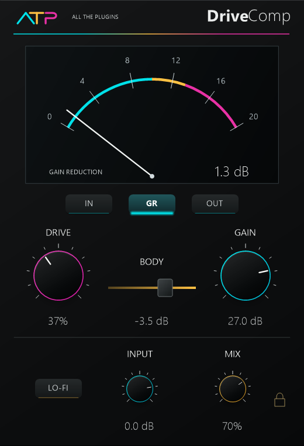

# DriveComp
---
A vocal compressor with drive, body shaping, dry/wet blending and a switchable lo-fi circuit.

**Inspired by:** Joey Sturgis Tones Gain Reduction

**Release version:** v1.0

# Overview
---
Shape vocal dynamics with DRIVE, adjust the low-end balance with BODY and use GAIN to set the output character. Blend the processed sound with the original using MIX, or engage LO-FI for a narrower, filtered tone. Input, output and reduction meters show the selected signal activity.

# Downloads
---
| Platform | Format | Download |
| --- | --- | --- |
| Windows x64 | VST3 | [Windows VST3](https://raw.githubusercontent.com/someonelikeTIM/all-the-plugins/ff2de316e50605ba40bc1663d93e0376f3feed70/downloads/windows/ATP-DriveComp-Windows-VST3.zip) |

# Install and use
---
Extract the ZIP. Copy the complete `ATP DriveComp.vst3` folder to `%LOCALAPPDATA%\Programs\Common\VST3` or your system VST3 folder, then restart or rescan your host. If replacing GR-208 Cleanroom, move its old bundle outside the scan folder first.

**Using the interface:** Drag knobs vertically or use the wheel. Shift gives fine adjustment; double-click or Ctrl-click resets a control. Drag BODY horizontally. The lock affects manual movement; automation and recall remain continuous.

**Defaults:** DRIVE 100%, GAIN +27.0 dB, BODY about -1.7 dB, INPUT 0.0 dB, MIX 100%, LO-FI off.

**Audio support and limits:** Windows x64 VST3, mono or stereo. DRIVE 0% is not bypass. Automation applies the final queued value to each audio block. No factory presets are provided. Required third-party notices are included in the distributed legal files.

| Control | Behavior |
| --- | --- |
| INPUT | Sets input level from -96 to +24 dB. |
| DRIVE | Controls the compression character. Low settings can strongly attenuate the signal; 0% is not bypass. |
| BODY | Adjusts the low shelf from -10 to 0 dB. |
| GAIN | Sets gain into the output nonlinearity from 0 to 36 dB. |
| MIX | Blends the original and processed signal from 0 to 100%. |
| LO-FI | Switches the filtered lo-fi circuit. |
| IN / GR / OUT | Selects input, reduction or output metering. A dash means there is no current reading. |
| Lock icon | Switches manual edits between detented and continuous movement. |
| Host Bypass / Module On | Separate host controls. Bypass returns the original input; Module On controls the internal processing path. |

# License
---
MIT License

Permission is hereby granted, free of charge, to any person obtaining a copy of this software and associated documentation files (the "Software"), to deal in the Software without restriction, including without limitation the rights to use, copy, modify, merge, publish, distribute, sublicense, and/or sell copies of the Software, and to permit persons to whom the Software is furnished to do so, subject to the following conditions:

The above copyright notice and this permission notice shall be included in all copies or substantial portions of the Software.

THE SOFTWARE IS PROVIDED "AS IS", WITHOUT WARRANTY OF ANY KIND, EXPRESS OR IMPLIED, INCLUDING BUT NOT LIMITED TO THE WARRANTIES OF MERCHANTABILITY, FITNESS FOR A PARTICULAR PURPOSE AND NONINFRINGEMENT. IN NO EVENT SHALL THE AUTHORS OR COPYRIGHT HOLDERS BE LIABLE FOR ANY CLAIM, DAMAGES OR OTHER LIABILITY, WHETHER IN AN ACTION OF CONTRACT, TORT OR OTHERWISE, ARISING FROM, OUT OF OR IN CONNECTION WITH THE SOFTWARE OR THE USE OR OTHER DEALINGS IN THE SOFTWARE.
