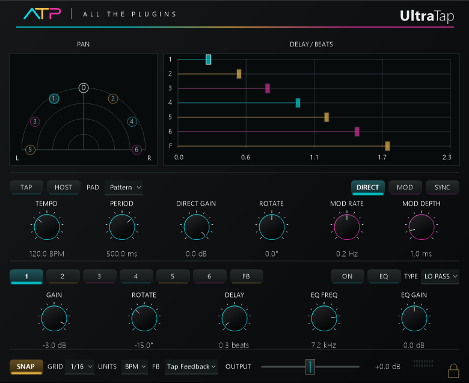

# UltraTap
---
A six-tap stereo delay with tempo sync, modulation, feedback and per-tap EQ.

**Inspired by:** Waves SuperTap

**Release version:** v1.0

# Downloads
---
| Platform | Format | Download |
| --- | --- | --- |
| Windows x64 | VST3 | [Windows VST3](https://raw.githubusercontent.com/someonelikeTIM/all-the-plugins/3246244f84c8b8f460ee2e3f707c50870a8bff65/downloads/windows/ATP-Echo-Parcel-Windows-VST3.zip) |

# Install and use
---
Extract the ZIP and copy the complete `ATP UltraTap.vst3` folder into `C:\Program Files\Common Files\VST3`. Replace the earlier copy of the same plugin, then restart or rescan your host. Windows x64 VST3; stereo input and output. Six-tap version only.

| Control | Behavior |
| --- | --- |
| TEMPO / PERIOD / HOST | Sets manual timing or follows the host tempo. HOST keeps the pad in Pattern mode. |
| TAP / PAD | Enters a tempo or places delay taps in a pattern. |
| DIRECT / DIRECT GAIN / ROTATE | Enables, levels and rotates the undelayed stereo signal. |
| MOD / SYNC / MOD RATE / MOD DEPTH | Enables shared modulation and sets its speed, tempo sync and depth. |
| Tap buttons / FB | Selects a tap or the feedback return for editing. |
| ON / EQ / TYPE | Enables the selected signal and chooses its filter. |
| GAIN / ROTATE / DELAY | Sets the selected tap’s level, rotation and timing. |
| EQ FREQ / EQ GAIN | Adjusts the selected filter. Cut filters ignore gain. |
| SNAP / GRID / UNITS | Controls timing snaps and graph display units. |
| FB mode | Selects the normalized tap return or separate feedback delay. |
| Graphs | Drag pan markers for level and rotation, or delay markers for timing. |
| OUTPUT / Meters | Sets output level; click the meters to reset held peaks. |
| Lock icon | Switches manual knob movement between detented and smooth. |

# License
---
MIT License

Permission is hereby granted, free of charge, to any person obtaining a copy of this software and associated documentation files (the "Software"), to deal in the Software without restriction, including without limitation the rights to use, copy, modify, merge, publish, distribute, sublicense, and/or sell copies of the Software, and to permit persons to whom the Software is furnished to do so, subject to the following conditions:

The above copyright notice and this permission notice shall be included in all copies or substantial portions of the Software.

THE SOFTWARE IS PROVIDED "AS IS", WITHOUT WARRANTY OF ANY KIND, EXPRESS OR IMPLIED, INCLUDING BUT NOT LIMITED TO THE WARRANTIES OF MERCHANTABILITY, FITNESS FOR A PARTICULAR PURPOSE AND NONINFRINGEMENT. IN NO EVENT SHALL THE AUTHORS OR COPYRIGHT HOLDERS BE LIABLE FOR ANY CLAIM, DAMAGES OR OTHER LIABILITY, WHETHER IN AN ACTION OF CONTRACT, TORT OR OTHERWISE, ARISING FROM, OUT OF OR IN CONNECTION WITH THE SOFTWARE OR THE USE OR OTHER DEALINGS IN THE SOFTWARE.
