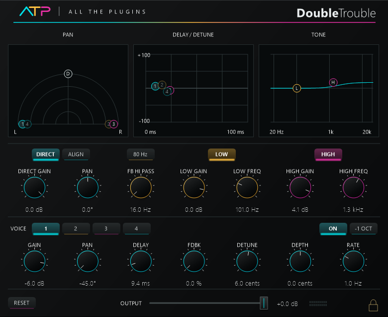

# Double Trouble
---
A four-voice stereo doubler with independent delay, detune, modulation and tone controls.

**Inspired by:** Waves Doubler

**Release version:** v1.0

# Downloads
---
| Platform | Format | Download |
| --- | --- | --- |
| Windows x64 | VST3 | [Windows VST3](https://raw.githubusercontent.com/someonelikeTIM/all-the-plugins/3246244f84c8b8f460ee2e3f707c50870a8bff65/downloads/windows/ATP-Offset-Choir-Windows-VST3.zip) |
| macOS 11+ | VST3 | [Mac VST3](https://raw.githubusercontent.com/someonelikeTIM/all-the-plugins/e317e1e98f327635bfec577cf0aeaf09cd4118f5/downloads/macos/ATP-Double-Trouble-macOS-universal-VST3.zip) |
| macOS 11+ | AU | [Mac AU](https://raw.githubusercontent.com/someonelikeTIM/all-the-plugins/e317e1e98f327635bfec577cf0aeaf09cd4118f5/downloads/macos/ATP-Double-Trouble-macOS-universal-AU.zip) |

# Install and use
---
**Windows:** Extract the ZIP and copy the complete `ATP Double Trouble.vst3` folder into `C:\Program Files\Common Files\VST3`. Replace the earlier copy of the same plugin, then restart or rescan your host. Windows x64 VST3; stereo input and output. Four-voice version only.

**Mac VST3:** Extract the ZIP and copy the complete `.vst3` bundle into `~/Library/Audio/Plug-Ins/VST3/`, then rescan your host.

**Mac AU:** Extract the ZIP and copy the complete `.component` bundle into `~/Library/Audio/Plug-Ins/Components/`, then rescan your AU host.

Mac downloads are universal Apple Silicon / Intel builds for macOS 11 or later, Developer ID signed and Apple notarized. Back up the previous version outside the host scan folders before replacing it.

| Control | Behavior |
| --- | --- |
| DIRECT / DIRECT GAIN / PAN | Enables, levels and positions the original signal. |
| ALIGN / 80 Hz–20 Hz | Aligns the direct signal and selects the pitch-analysis range. The 20 Hz range increases the minimum processing delay. |
| FB HI PASS | Filters low frequencies from the feedback return. |
| LOW / HIGH | Enables each tone shelf; the gain and frequency knobs set its response. |
| VOICE 1–4 / ON | Selects a voice for editing and enables or silences it. |
| GAIN / PAN / DELAY | Sets the selected voice’s level, position and delay. |
| FDBK / −1 OCT / DETUNE | Sets feedback, octave shift and pitch offset. |
| DEPTH / RATE / RESET | Sets pitch modulation and resets its phase. |
| Graphs | Drag markers to adjust pan and gain, delay and detune, or tone frequency and gain. |
| OUTPUT / Meters | Sets final level and displays stereo output. |
| Lock icon | Switches manual knob movement between detented and smooth. |

# License
---
MIT License

Permission is hereby granted, free of charge, to any person obtaining a copy of this software and associated documentation files (the "Software"), to deal in the Software without restriction, including without limitation the rights to use, copy, modify, merge, publish, distribute, sublicense, and/or sell copies of the Software, and to permit persons to whom the Software is furnished to do so, subject to the following conditions:

The above copyright notice and this permission notice shall be included in all copies or substantial portions of the Software.

THE SOFTWARE IS PROVIDED "AS IS", WITHOUT WARRANTY OF ANY KIND, EXPRESS OR IMPLIED, INCLUDING BUT NOT LIMITED TO THE WARRANTIES OF MERCHANTABILITY, FITNESS FOR A PARTICULAR PURPOSE AND NONINFRINGEMENT. IN NO EVENT SHALL THE AUTHORS OR COPYRIGHT HOLDERS BE LIABLE FOR ANY CLAIM, DAMAGES OR OTHER LIABILITY, WHETHER IN AN ACTION OF CONTRACT, TORT OR OTHERWISE, ARISING FROM, OUT OF OR IN CONNECTION WITH THE SOFTWARE OR THE USE OR OTHER DEALINGS IN THE SOFTWARE.
