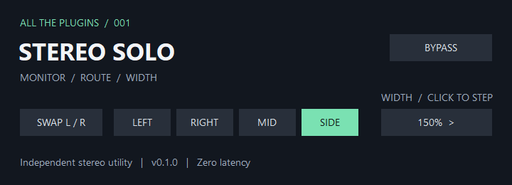

# ATP Stereo Solo 0.1.0

Windows x64 VST3 functional reconstruction of the core audio controls in bx_solo. Independently implemented and published under its own name, plugin identity and interface. It does not contain or install the original vendor's binary, graphics or licensing system, and is not affiliated with Brainworx or Plugin Alliance.

[Download the VST3 module](https://raw.githubusercontent.com/someonelikeTIM/all-the-plugins/main/plugins/vst3/win-x64/ATP%20Stereo%20Solo.vst3/Contents/x86_64-win/ATP%20Stereo%20Solo.vst3).

## Install and use

Download the repository ZIP and copy the complete `plugins/vst3/win-x64/ATP Stereo Solo.vst3` folder into `%LOCALAPPDATA%\Programs\Common\VST3` or your system VST3 folder, then rescan your host. Windows 10/11 x64 with Universal C Runtime is required. The bundle contains one module, has no external sample/preset dependencies, and is unsigned.

| Control | Behavior |
| --- | --- |
| Swap L/R | Exchanges the processed stereo channels |
| Left / Right / Mid / Side | Monitors the selected signal on both outputs; click it again to clear the selection |
| Width | Cycles through Mono, 50%, 100%, 150%, 200%, 300% and 400% |
| Bypass | Passes input through unchanged |

The editor selects one solo at a time. Default width is 100%; the host parameter list provides direct selection and automation. Routing is width → swap → solo. If host automation enables multiple solo flags, priority is Side, Mid, Right, Left. Mid is `(L+R)/2`; side is `(L-R)/2`, multiplied by the selected width. Width can increase peaks, and this utility does not limit or clip them. Processing is stereo, zero-latency, and supports 32/64-bit floating point.

## License

This specific independently implemented binary is licensed under the MIT license reproduced below. The repository's existing GPL-3.0 license remains in place for repository material; it does not replace this binary's explicit license. Required bundled library notices are in [THIRD-PARTY-NOTICES.md](THIRD-PARTY-NOTICES.md).

Copyright (c) 2026 someonelikeTIM

Permission is hereby granted, free of charge, to any person obtaining a copy of this software and associated documentation files (the "Software"), to deal in the Software without restriction, including without limitation the rights to use, copy, modify, merge, publish, distribute, sublicense, and/or sell copies of the Software, and to permit persons to whom the Software is furnished to do so, subject to the following conditions:

The above copyright notice and this permission notice shall be included in all copies or substantial portions of the Software.

THE SOFTWARE IS PROVIDED "AS IS", WITHOUT WARRANTY OF ANY KIND, EXPRESS OR IMPLIED, INCLUDING BUT NOT LIMITED TO THE WARRANTIES OF MERCHANTABILITY, FITNESS FOR A PARTICULAR PURPOSE AND NONINFRINGEMENT. IN NO EVENT SHALL THE AUTHORS OR COPYRIGHT HOLDERS BE LIABLE FOR ANY CLAIM, DAMAGES OR OTHER LIABILITY, WHETHER IN AN ACTION OF CONTRACT, TORT OR OTHERWISE, ARISING FROM, OUT OF OR IN CONNECTION WITH THE SOFTWARE OR THE USE OR OTHER DEALINGS IN THE SOFTWARE.
